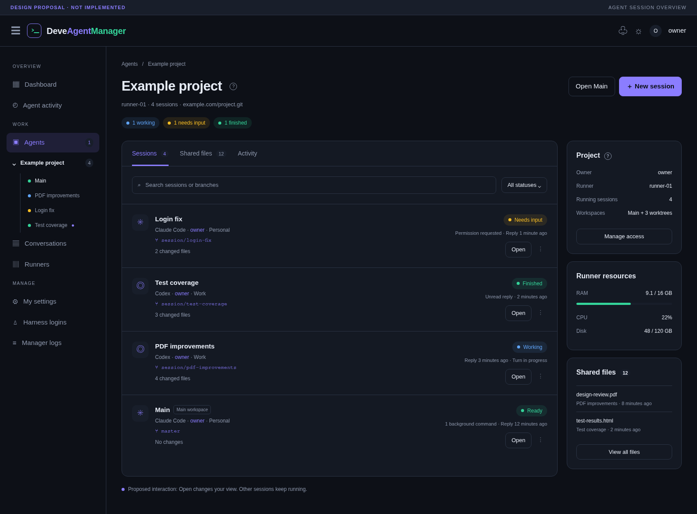
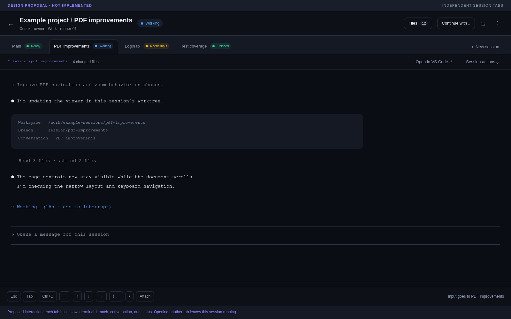
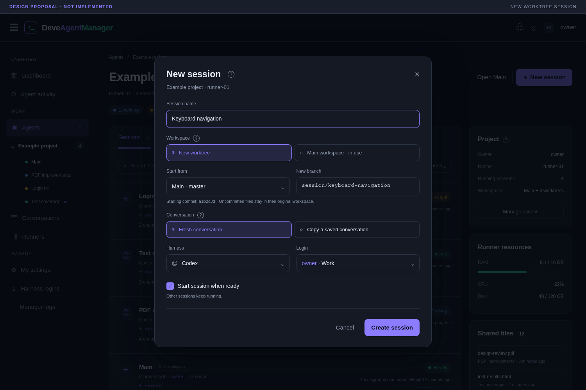
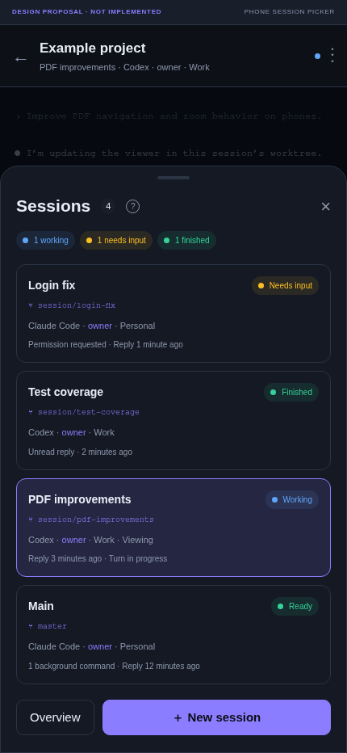
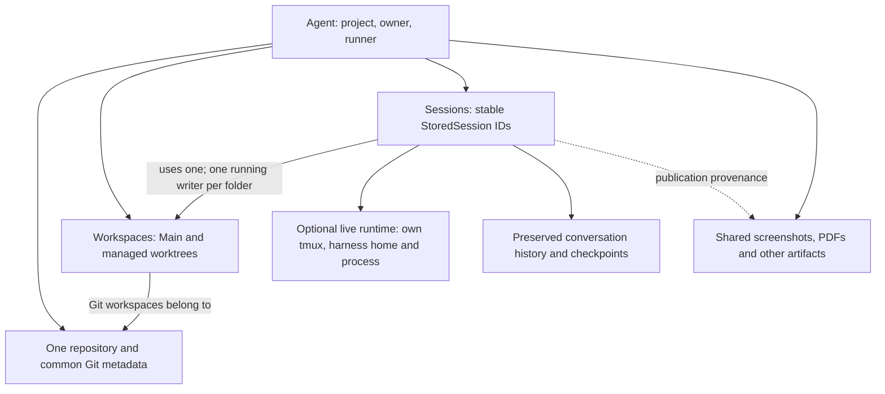
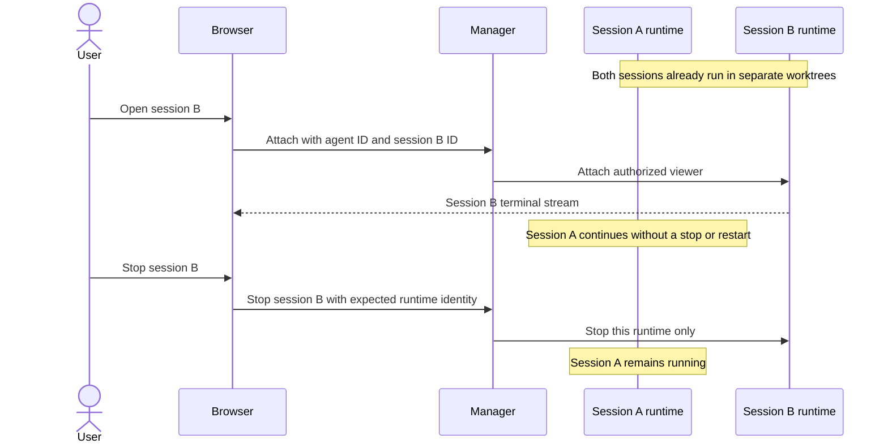
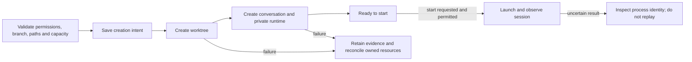

# Multiple concurrent sessions per agent with Git worktrees

Design proposal only. The images are static mockups; this document does not implement the feature.

An agent becomes the container for a project on one runner. It can contain several independently running sessions, normally using separate Git worktrees. Opening another session changes the viewer's terminal without stopping another session.

## Problem and intended outcome

Today an agent owns one terminal, harness session, working directory and effective login. Selecting a saved conversation stops the current harness, saves its history and launches the selected conversation in the same folder. Conversations are separate, but their code and running terminal are not.

For example, someone should be able to leave a PDF task working in one session, open a login fix in another worktree, and read a completed testing session from their phone. Those operations must not interrupt another turn, share a writable folder accidentally, switch another session's login, or redirect its scheduled continuation.

The proposed first release keeps one repository and one runner per agent. Parallel sessions share the project identity, ownership and artifact collection. Their code folders, conversations, runtimes and execution controls are separate.

## Interface mockups

Illustrative data only. Colors follow the existing Manager theme. Main is shown as a fixed navigation shortcut; session lists follow latest-reply order. Open terminal tabs can retain their opening order.

### Agent overview

One agent expands into sessions. The overview reports working, blocked and unread sessions separately. The Main session remains Ready while its persistent background command runs. Opening any row changes the viewer's selection, without stopping another session.

Terminal with independent session tabs

The selected terminal shows its session, branch, effective login and status. Commands and editor links target that session. Other tabs retain their statuses, including Needs input and unread Finished results.

New session and worktree dialog

Default to a fresh conversation in a new worktree and branch. Conversation ancestry and code starting point are separate selections. Main is unavailable for another running session while its existing session owns it. The example creates a new Keyboard navigation session alongside existing sessions.

Phone session picker

On phones, a scrollable sheet replaces the desktop tab strip. It identifies the session currently viewed and retains statuses for other sessions. Opening a stopped session offers Start; opening it alone does not launch anything. The four-row example fits the viewport; longer lists must scroll within the sheet.

[Editable mockup source](./mockups.html). Open it locally with `?view=overview`, `?view=terminal`, `?view=creation` or `?view=mobile`. The file has no external dependencies or application API calls; its controls are nonfunctional. PNGs were captured in Chromium at 1600×1180, 1600×1000, 1500×1000 and 430×932 respectively. Exact wording and spacing remain design decisions.

## Ownership model

| Concept | Owns |
| --- | --- |
| Agent | Project identity, owner, inherited sharing, runner, repository, artifact collection |
| Session | Conversation identity, harness, login selection, workspace assignment, activity, notifications, continuation policy |
| Workspace | Working folder, Main/linked-worktree/plain-folder kind, branch, base commit, Git registration, managed ownership |
| Runtime | Current tmux target, native harness session, private harness directory, process identity, lifecycle state |

Reuse the existing `StoredSession.Id` as the public session identity. Add runtime state in a companion record rather than inventing a second competing public session ID. Saved conversations must remain readable after their runtime, workspace or parent agent is removed.

An agent owns several sessions and workspaces. Each attached session uses one workspace. Several saved conversations may refer to the same workspace, but only one managed session may run there at a time, including while its prompt is Ready. Distinct worktrees can run concurrently. A retained background process can also prevent handing a workspace to another writer until it is reviewed.

Store durable session/workspace IDs independently of display names and branch names. Renaming a session must not rename its folder, native history, tmux target or Git branch.

## Session navigation and lifecycle

There is no global selected session that controls execution. Use a stable route such as `/agents/{agentId}/sessions/{sessionId}`. Each browser can view a different session; remembering a last-viewed session is a navigation preference only.

| Action | Behavior |
| --- | --- |
| Open | Attach this viewer to the exact session; leave other processes running |
| Start | Launch or resume this session only, after workspace and login checks |
| Stop / Restart | Affect this session only; distinguish its background processes |
| Close tab | Close the view; leave the session running |
| Continue with | Change this session's harness/login in the same workspace |
| Archive | Stop the session and preserve its history and workspace |
| Remove workspace | Separate reviewed operation; preserve conversations and branches by default |
| Stop all / Move agent | Explicitly named operations across the entire agent |

The existing global Sessions page should remain a searchable conversation archive, linked to project/session runtimes where available. The agent picker becomes a session overview with status, branch, login, latest reply, changes and actions. Desktop tabs may collapse into the phone picker. Every loading list, menu and dialog retains placeholders, errors and Retry behavior; refreshes keep displayed data.

## Creating a session

1. Validate project write access, runner access/readiness, harness support and login Use permission. Check repository ownership, destination, branch and capacity.
2. Resolve the starting revision to an exact commit. Default to the selected workspace's committed HEAD and display that choice. Dirty files stay in their original workspace.
3. Persist creation intent with stable IDs and ownership of any new paths/branches.
4. Create the worktree in a sibling managed directory outside Main. Respect existing Git branch-checkout and path safeguards.
5. Create a fresh conversation, or a verified copy with source-session/checkpoint provenance. Conversation copying does not copy the source workspace's dirty files.
6. Prepare the private runtime and selected login. Start only if requested and capacity is available. A prepared, stopped session remains useful.
7. After a restart or lost transport, inspect existing worktree/process identity before reconciling. Never repeat uncertain launch or initial prompt delivery automatically. Clean up only resources proven to belong to this operation.

Fresh conversation + new worktree is the default. Copying a saved conversation is explicit, preserves native source backups and does not replay historical tools. Only verified snapshots may be used. If a source is still working, the product must identify the checkpoint being copied; support for copying an active/incomplete exchange must be proven before enabling it. Otherwise require a settled checkpoint.

A complete dirty-workspace fork is deferred: tracked edits, staged state, binaries, untracked/ignored files and deletions require a separately designed snapshot operation. Never imply that a conversation copy reproduces the code state it discussed.

## Git and workspace rules

- One agent owns one repository on one runner in the first release. Do not deduplicate unrelated agents just because their remote URLs match.
- Keep the existing checkout as Main and place new managed worktrees in sibling directories with stable IDs. Detect external or externally linked repositories; do not adopt or delete their common metadata implicitly.
- Give new worktrees unique branches. Do not override Git's same-branch safeguard, force-reset an existing branch or overwrite an existing directory.
- Creation does not silently fetch/pull, stash, commit, push or merge. Record the resolved base commit and refresh metadata when a user changes a branch outside DAM.
- Include the user-selected branch in task instructions. Reconcile repository policies such as “always push to master” so parallel sessions do not all target the shared integration branch.
- Repository-local Git configuration is shared. Session-specific environment or identity choices must not unexpectedly change another session's behavior.
- Existing non-Git folders continue as shared workspaces with one running writer. Separate-folder copies are not labelled Git worktrees.
- Submodules, Git LFS, sparse checkouts, symlinks and external worktrees need compatibility checks. Submodule worktrees should remain unavailable until proven rather than be assumed safe.

Use Git's supported worktree discovery/removal/repair operations, with capability checks against the installed Git version. Git documents shared metadata/configuration, branch checkout restrictions and incomplete submodule support: [git-worktree](https://git-scm.com/docs/git-worktree).

## Harness runtimes and logins

Every live session needs its own tmux target, native conversation ID, mutable harness directory, effective login, process identity and observations. Session display names are not runtime identities. Support legacy runtime paths during migration until an explicit safe restart can adopt the new layout.

Verify each supported harness independently: concurrent launch, resume, native-file discovery, history preservation, mutable settings, model selection and account switching. Pi's configuration arrangement differs from the other harnesses and needs a dedicated isolation check. Native CLI session switches must not bind a process to another managed session accidentally.

Continue with stops, verifies, converts/resumes and restarts only the selected session, retaining its workspace and source backup. It must not rewrite another runtime's auth link, reset its activity, or change its account. Keep shared settings/packages where safe; do not share mutable history databases.

The parent agent's owner and sharing rules are inherited initially. Do not add a second child ACL system for this release. A standalone conversation share remains history access, not permission to control the project or read unrelated artifacts. Administrative visibility alone does not grant subscription Use permission. Login revocation must stop/block all affected session runtimes, including those not being viewed, without changing unrelated sessions or falling back to ambient credentials.

## Explicit targeting, observation and background work

Audit every agent-ID-only operation. Terminals, input, uploads, editor links, viewers, clipboard actions, quick commands, Stop/Restart, diagnostics, seen/dismiss actions, usage-limit schedules and job-completion delivery must target an explicit session. Validate parent membership, access and expected runtime identity at the execution boundary.

Use session-specific API/socket routes and include agent/session identity in live events and outbox publications. Never use the browser's last-viewed session to resolve an execution target. Existing agent execution endpoints can remain compatible when there is exactly one session; ambiguous multi-session requests require an explicit target.

Move activity, completion acknowledgement, dismissal, usage-limit policy and schedule state to session ownership. Preserve draft, process, rejection, clock anchoring and uncertain-delivery protections. A tab change cannot cancel a schedule or redirect its `continue`. Sessions can share a subscription quota even when their policies are independent.

Job completions return only to their originating session/conversation. A stopped session retains the result for later; delivery cannot fall through to whichever session is visible. Preserve outbox deduplication and never relaunch a workload after ambiguous delivery. This must include the existing job-completion regression tracked in [#5](https://github.com/devedse/DeveAgentManager/issues/5).

Observe all runtimes independently of viewers. Keep batched runner observations, incremental history transfer, bounded reads and full verification at lifecycle checkpoints. Opening more tabs must not create a polling loop per tab. Synchronization must no longer depend on one selected conversation.

The agent list reports child counts such as “1 working · 1 needs input · 1 finished.” The terminal reports its selected session's exact status. Bell entries and sound deduplication use session/completion identity; viewing one reply cannot acknowledge another. Keep background-command counts separate from turn completion. Agent lists order by the latest child reply, and session lists by their own latest replies, with never-replied sessions following newest first.

## Screenshots, documents and other artifacts

Preserve the existing agent-wide artifact collection, including screenshots, PDFs, shared documents, uploads and cached files. Each publication retains its source session as provenance. Offer “This session” and “All agent files” views without duplicating large files for every session.

An unselected running session can still publish. Validate its membership and publication capability rather than requiring it to be selected. Keep conversation-only share boundaries. Copies retain needed attachments independently; archival or workspace removal must not remove files still referenced elsewhere. Existing IDs, download/viewer links and collection indexes survive migration and VM moves.

## Concurrency, capacity and failure recovery

Replace the global session-operation lock gradually with session lifecycle/history coordination, workspace execution ownership and repository coordination for worktree changes. Define a consistent order for operations affecting several resources. Use database constraints/durable operation state where needed; never hold a database transaction through SSH transfer.

Parallel worktrees still share CPU, RAM, ports, desktop state, subscriptions and external databases. Add explicit start controls and configurable runner capacity; exceeding capacity prepares a stopped session or reports the reason rather than starting silently. Resource summaries are runner-wide. Avoid another OOM incident from starting several heavy builds/editors at once.

Do not share writable Unity Library folders, build outputs or local databases between worktrees. Package caches may be reused only where their tools support concurrency. Worktree creation must not run additional project setup commands without the chosen setup policy. Stopping a harness does not imply that persistent servers or watchers have stopped.

Use durable creation/cleanup checkpoints and existing reconciliation patterns; a generic workflow engine is not required. After crashes, reconcile operation intent with Git registration, filesystem ownership and process identities. Preserve ambiguous states for explicit recovery. An observed recap, resize or draft change is not a new turn or completion.

## Review, archive and cleanup

Initially use the existing harness/Git/PR workflow to commit, push, review and integrate branches. Show branch/change state and review links; a graphical merge system and automatic integration are deferred. Integration into a workspace must respect its running writer and background processes.

Archive stops the session while retaining conversation and workspace. Remove workspace is separate and reviews tracked/staged edits, untracked and ignored files, unmerged commits, and remaining processes. A clean Git status does not establish that ignored output is disposable. Preserve branches and history by default. Never remove Main or externally owned directories automatically.

## Moving an agent to another VM

The existing mover rejects linked Git worktrees. Do not merely remove that check.

Move agent means the complete repository and session set: Main/common Git metadata, managed worktrees, exact dirty/ignored files, private runtimes, native history/replay files, referenced uploads/cache paths and pending publications. Manager-stored screenshots, PDFs, documents and collection indexes retain their identities.

Record which sessions were running, freeze conflicting lifecycle/worktree changes, review background-process stops, stop source runtimes and fully verify histories. Transfer and validate the complete set and Git registrations, preserving paths where possible. Reconcile/repair Git links after restoration. Resume only sessions previously running, without replaying prompts or jobs.

Commit the destination only after required destination runtimes are confirmed. Before fallback, establish that destination runtimes have stopped; uncertain process state requires recovery instead of starting both copies. Source cleanup failure after commit cannot roll back the live destination. Retain existing progress, latest-move details and cleanup retry behavior, extended across sessions/workspaces.

Moving an individual child to another VM is deferred; it would need an independent repository arrangement rather than a linked worktree across machines. Unsupported external repository links remain explicitly blocked.

## Existing-agent migration and rollout

1. Make schema/service changes additive first. Preserve existing public conversation IDs, ownership/shares, artifacts, native IDs, completion acknowledgements, login selections and schedules.
2. Register the existing working folder as Main and adopt the current process/runtime without restarting it solely for migration. Remove the unique selected-session constraint only when all execution and observation paths can address multiple sessions safely.
3. Associate saved conversations with Main. They shared one folder and do not establish historical code snapshots. They remain resumable sequentially; concurrent use requires an explicitly created worktree and code starting point.
4. Maintain legacy routes for the unambiguous single-session case and redirect navigation to explicit session URLs. Do not guess an execution target after multiple sessions exist.
5. Enable behind a feature flag after the necessary permissions, callbacks, history and move behavior is covered. Use disposable fixtures before a limited operator rollout.
6. Document rollback: stop extra sessions deliberately and verify histories before returning to single-session mode. Old binaries must not operate directly on agents with multiple live runtimes or incompatible schema assumptions.

## Delivery milestones

- [ ] **1. Prove compatibility:** real harness isolation/resume experiments; Git layout, account behavior, source checkpoint copying and artifact identity verified in disposable fixtures.
- [ ] **2. Introduce ownership and migration:** stable session identities, workspace/runtime records, existing process adoption and single-session compatibility.
- [ ] **3. Enable independent execution:** explicit API/socket targets, per-session lifecycle/logins, workspace ownership and safe concurrency.
- [ ] **4. Add worktrees and navigation:** durable creation, branch policy, overview, terminal tabs, phone picker, new-session dialog and loading/error states.
- [ ] **5. Complete cross-cutting behavior:** activity/notifications, continuations, job delivery, artifacts, permissions, incremental sync, capacity and reconciliation.
- [ ] **6. Extend moves and cleanup:** complete-agent transfer, multi-runtime validation, fallback and safe workspace removal.
- [ ] **7. Roll out gradually:** flag, operator runbook, resource/recovery observation and documented rollback.

## Acceptance and regression matrix

| Area | Required evidence |
| --- | --- |
| Navigation | Opening A/B from two devices leaves both processes alive; closing views stops neither; stopped views do not launch |
| Runtime isolation | Separate harness homes/native IDs, account changes and revocation, resume/restart, native CLI session changes, stale requests |
| Creation | Concurrent requests, branch/path collisions, dirty source, duplicate names, interrupted SSH, restart after each checkpoint, no uncertain launch replay |
| Git | Main/linked/external paths, same-branch refusal, branch drift, deleted worktrees, repair, submodules/LFS/sparse compatibility gating |
| History | Exact native records and attachments; active branches; verified copy/switch/export; bounded transfer across all sessions |
| Notifications | Independent states, aggregate counts, exact-session links, unseen acknowledgement, sound deduplication, background shells and recap redraws |
| Continuations/jobs | Correct unselected target, stopped session, drafts, new rejection, runtime change, quotas, durable deduplication and uncertain sends |
| Artifacts/access | Background publication, source provenance, PDF/image/download links, standalone conversation shares, no cross-session write/control leakage |
| Cleanup | Tracked/staged/untracked/ignored files, retained branches, unmerged commits, background processes and externally owned paths |
| VM moves | Complete repository/worktree graph, dirty/ignored files, exact histories, screenshots/documents, running/stopped restoration, failure/fallback/uncertainty |
| Browser | Desktop/phone, long names, many sessions, picker scrolling, light/dark, slow/failing API, retry, status changes without terminal viewers |
| Capacity | Batched polling, bounded sync, multiple heavy tasks, port conflicts, capacity rejection without silent starts or stopping another session |
| Migration | Existing live process adoption, legacy Main histories, preserved IDs/shares/policies, interrupted migration and rollback restrictions |

## Boundaries and decisions to validate

Recommended defaults are one runner/repository per agent, inherited parent access, fresh conversations in new worktrees, explicit starts, one running writer per workspace and whole-agent moves. Confirm installed-harness isolation and Git/project compatibility in milestone 1 before promising support.

Automatic task orchestration, automatic merges, child sessions on different VMs, complete dirty-workspace forks and a separate child permission system are outside the first release. Native harness subagents/background shells remain harness-internal work; they are not automatically converted into Manager sessions or worktrees.

## Current code affected

- `DeveAgentManager.Core/Data/Entities.cs` and `ManagerDbContext.cs`: agent-owned runtime fields, saved workspace ownership and unique selected-session relationship.
- `DeveAgentManager.Core/Agents/AgentService.cs`: launch/stop, session selection, harness switching and observations currently targeting one agent runtime.
- `DeveAgentManager.Core/Sessions/SessionService.cs`: selected-session lookup, switching, history discovery, verification and global operation coordination.
- `DeveAgentManager.Core/Accounts/AccountRuntime.cs`: private runtime directory currently separated by agent/harness rather than session.
- `DeveAgentManager/Api/AgentEndpoints.cs`, `TerminalSocketEndpoint.cs`, editor/upload routes and the client API: explicit session execution targets.
- `AgentContinuations`, `AgentJobCompletions`, `AgentActivityTracker`, attention, live events, artifact publication and `AgentMoves`: ownership and delivery behavior.
- `SessionPickerDialog`, `AgentSwitchMenu`, `AgentTerminal`, session archive, agent lists, status dialogs and navigation: new viewing and control model.

Relevant existing behavior: [conversation synchronization](../../lean-session-sync.md), [artifacts](../../agent-artifacts.md), [usage-limit continuations](../../usage-limit-continuations.md), [VM moves](../../agent-moves.md) and [harness conversion formats](../../session-formats.md).
